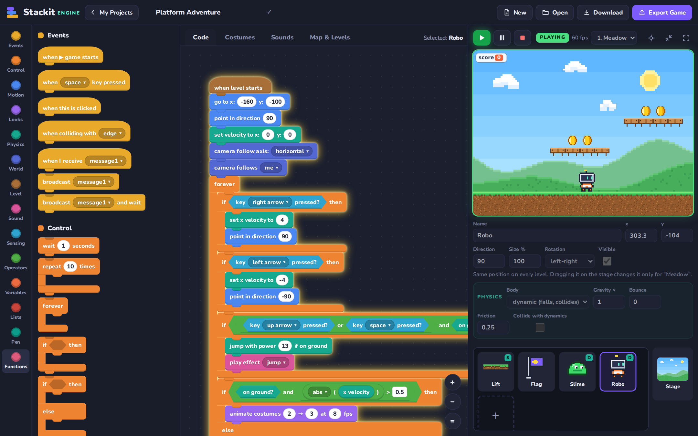
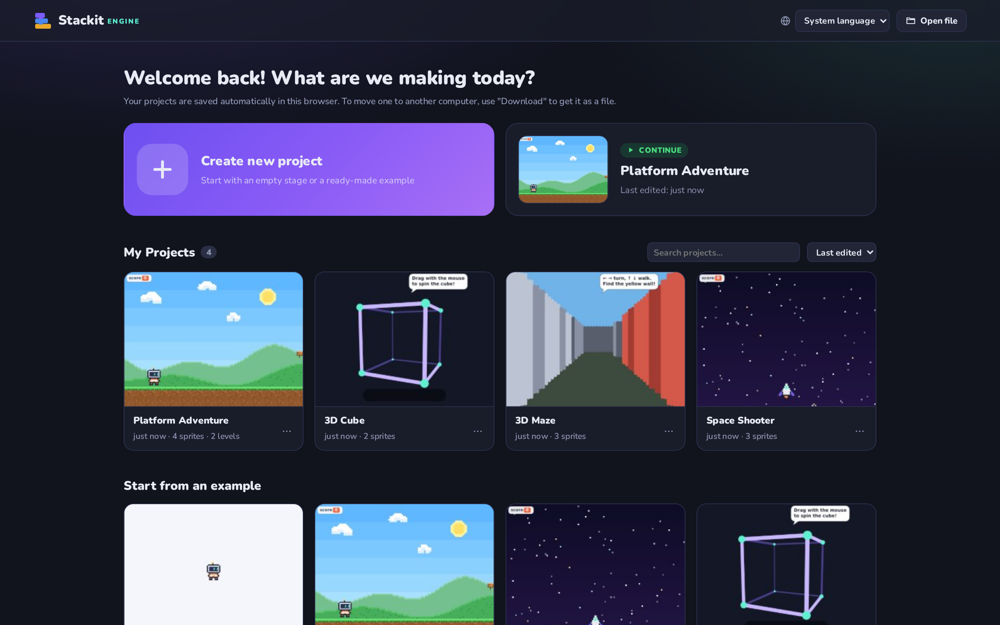
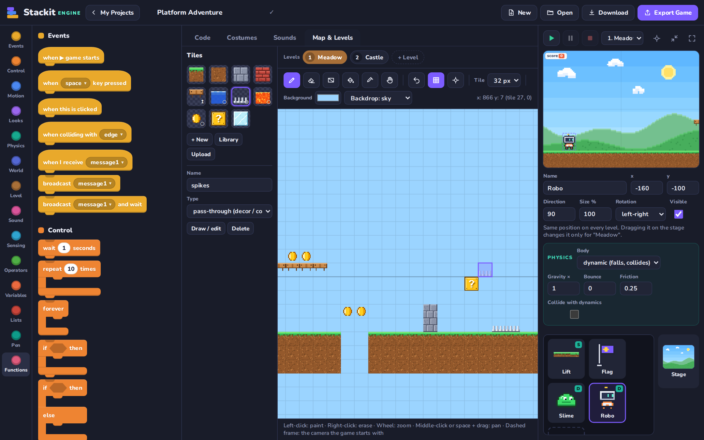
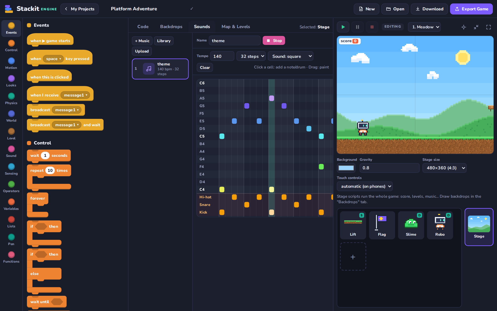
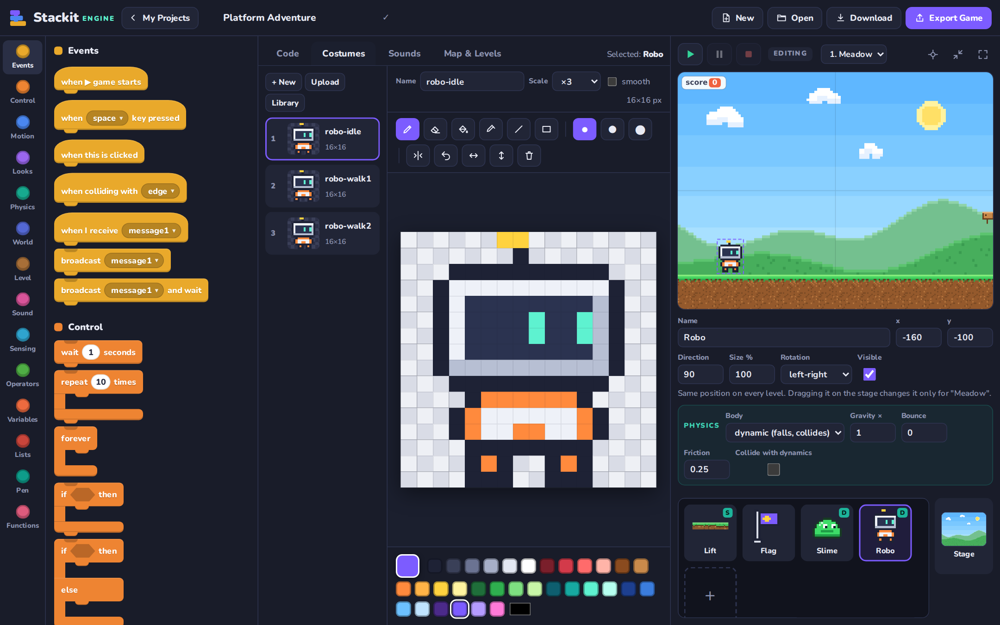
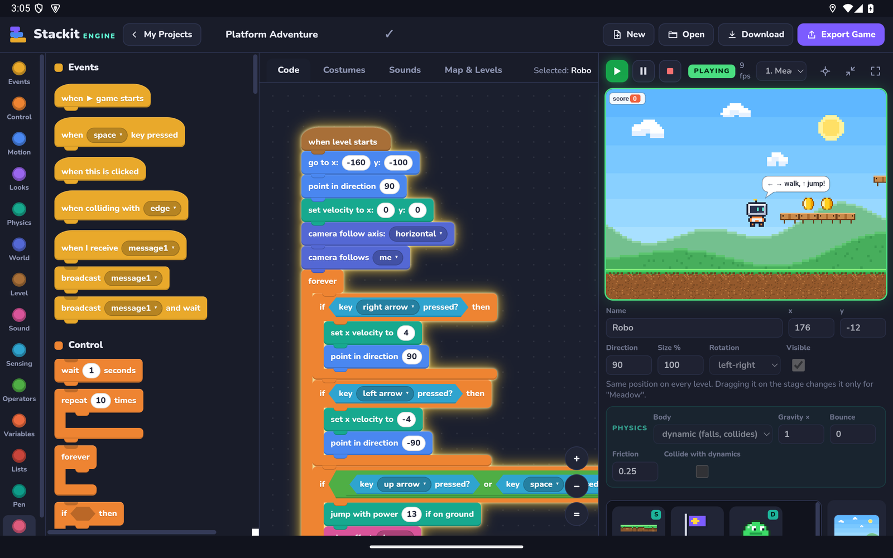
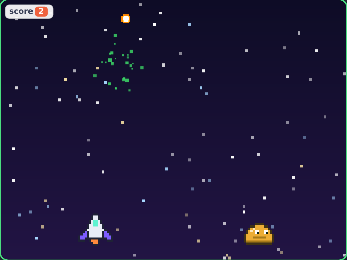
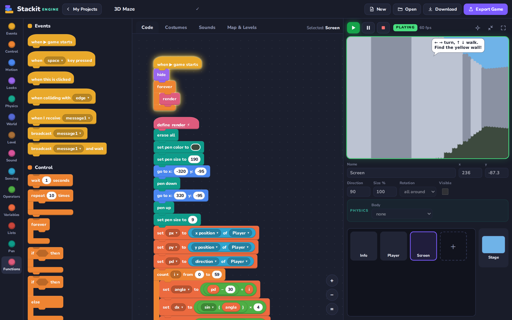
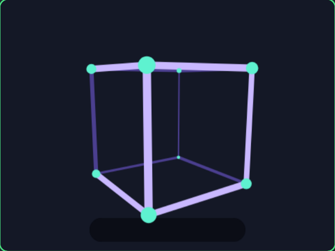

<p align="center">
  
</p>

<h1 align="center">Stackit Engine</h1>

<p align="center">
  <b>Make real 2D games with Scratch-style blocks.</b><br>
  Physics, tile maps, levels, a music maker and a pixel editor — on Windows, Linux, Android and the web.
</p>

<p align="center">
  <a href="https://github.com/isnowx17/StackitEngine/releases/latest"></a>
  <a href="LICENSE"></a>
  
  
</p>

<p align="center">
  <b>English</b> · <a href="README.tr.md">Türkçe</a>
</p>

<p align="center">
  <a href="#download"><b>⬇ Download</b></a> ·
  <a href="#screenshots">Screenshots</a> ·
  <a href="#features">Features</a> ·
  <a href="#build">Build from source</a>
</p>



You write code by dragging and snapping blocks together; underneath runs a real engine with a **fixed 60 Hz simulation loop**, physics, a camera, clones, particles and pixel-perfect collision detection. When your game is done, export it as **a single HTML file** that runs in any browser — with on-screen touch controls on phones.

The interface is available in **English and Turkish** and follows your system language automatically (you can switch it on the *My Projects* screen).

<a id="download"></a>

## ⬇ Download

| Platform | File | Notes |
|---|---|---|
| **Windows 10/11** | [Stackit-Engine-1.0.0-windows-portable.exe](https://github.com/isnowx17/StackitEngine/releases/latest/download/Stackit-Engine-1.0.0-windows-portable.exe) | Single file, no installation |
| Windows 10/11 | [Stackit-Engine-1.0.0-windows-x64.zip](https://github.com/isnowx17/StackitEngine/releases/latest/download/Stackit-Engine-1.0.0-windows-x64.zip) | Extract and run `Stackit Engine.exe` |
| **Linux** | [Stackit-Engine-1.0.0-linux-x86_64.AppImage](https://github.com/isnowx17/StackitEngine/releases/latest/download/Stackit-Engine-1.0.0-linux-x86_64.AppImage) | `chmod +x` and run |
| Debian / Ubuntu | [Stackit-Engine-1.0.0-linux-amd64.deb](https://github.com/isnowx17/StackitEngine/releases/latest/download/Stackit-Engine-1.0.0-linux-amd64.deb) | `sudo apt install ./Stackit-Engine-1.0.0-linux-amd64.deb` |
| **Android 7+** | [Stackit-Engine-1.0.0-android.apk](https://github.com/isnowx17/StackitEngine/releases/latest/download/Stackit-Engine-1.0.0-android.apk) | Tablets recommended; landscape |
| **Browser** | Clone or download this repo and open `index.html` | Nothing to install, works offline |

> **You may see a warning on first launch:** the Windows files are not code-signed, so SmartScreen may say "Windows protected your PC" → click **More info → Run anyway**. On Android, allow your browser / file manager to "install unknown apps". Some Linux distributions need `libfuse2` for AppImages.

<a id="screenshots"></a>

## 📸 Screenshots

| My Projects | Tile maps & levels |
|---|---|
|  |  |
| **Music maker (notes + drums)** | **Pixel costume editor** |
|  |  |
| **On an Android tablet** | **Space Shooter example** |
|  |  |
| **3D Maze — raycasting made of blocks** | **3D Cube — pen + math** |
|  |  |

<a id="features"></a>

## ✨ Features

| | |
|---|---|
| **Block editor** | 14 categories, ~150 blocks. Snap-together puzzle blocks, C blocks (if/else, loops), value and boolean slots, drop-down menus. Zoom, pan, undo/redo, right-click menu (duplicate / delete / edit). |
| **Engine** | Fixed-step 60 Hz loop, generator-based multithreading (hundreds of scripts at once), camera (follow, axis lock, zoom, shake), clones (up to 300), particle system, pen layer, speech bubbles, variable monitors. |
| **Physics** | Dynamic bodies (gravity, friction, bounce), solid bodies (ground / walls), *on ground? / hit a wall? / hit the ceiling?* sensors, kinematic velocity. **Moving platforms carry the sprites standing on them**; optionally, dynamic sprites collide with each other and can stand on top of one another. |
| **Tile maps** | Paint levels on a grid: pen, eraser, rectangle, bucket, picker, pan, undo. Tile types: *solid*, *one-way* (jump through from below, stand on top), *pass-through* (coins, spikes, lava, water…). 11 built-in tiles, or draw your own. |
| **Levels** | Each level has its own map, background, backdrop and sprite start positions. `when level starts` and `go to next level` blocks; variables such as the score are kept between levels. |
| **Music & sound** | Upload sound files (mp3 / wav / ogg) or make your own tunes with the **step-based music maker**: notes plus kick / snare / hi-hat. Built-in sound effects (jump, coin, explosion, laser…) and note playback — no files needed. |
| **Collision** | Bounding boxes trimmed to the visible pixels plus pixel-perfect touch tests; a *when colliding with X* event block. |
| **Costume editor** | Pixel drawing: pen, eraser, bucket, picker, line, rectangle, mirror drawing, flipping, undo. Image upload and a built-in pixel-art library. |
| **Functions** | Your own blocks with parameters; optional "run without screen refresh" (warp). |
| **My Projects** | A start screen with *Create new project* (blank or from an example), *Continue*, project cards with previews, search and sorting; rename / duplicate / download / delete. Projects are saved automatically to IndexedDB. |
| **Export** | Download / import `.stackit` project files. **Single-file HTML games** that open in any browser and show touch controls on phones. |
| **3D-looking games** | No special 3D blocks: the *3D Cube* and *3D Maze* examples show how pen, math and list blocks create a 3D look — rotation and perspective projection, and Wolfenstein-style raycasting over a tile map. |
| **Two languages** | English and Turkish UI, block texts, examples and exported games — picked from the system language. |

## 🎮 Example projects

- **Platform Adventure** — two tile-map levels (Meadow → Castle), a moving lift, a question box, spikes and lava, coin collecting, stomping on the enemy, background music.
- **Space Shooter** — clone-powered bullets and enemies, key events, particle explosions.
- **3D Cube** — a spinning wireframe cube: vertices rotated with `sin`/`cos`, projected with perspective, front edges thick and bright, back edges thin and dim. Drag with the mouse to spin it.
- **3D Maze** — Wolfenstein-style: one ray per screen column steps forward until it hits a tile; nearer walls are drawn taller and brighter. The maze lives in the *Map & Levels* tab, so you can repaint it.

Open them from the **Start from an example** section on the *My Projects* screen.

## 🧠 How it works

- **Projects:** the *My Projects* screen opens first. In the editor the address becomes `#/p/<id>`, so refreshing keeps the project open and the browser's back button returns to *My Projects*. To move a project to another computer or back it up, use **Download** to get a `.stackit` file.
- **Edit mode / play mode:** ▶ runs the game on a copy of the stage; ■ restores the stage to how you set it up (like a real game engine). In edit mode, drag sprites on the stage to place them, zoom with the wheel and drag empty space to pan.
- **Coordinates:** the centre is (0,0), x grows to the right, y grows upwards. Direction: 90 = right, 0 = up.
- **Levels:** ▶ starts from the level you are editing; exported games always start from level 1. Dragging a sprite on the stage changes its position only for the level being edited.
- **Physics units** are per frame: `x velocity 4` = 240 pixels per second; `gravity 0.8` = velocity drops by 0.8 every frame.
- **Click a script** to run just that script (it glows). Click a value block to see its value in a bubble. Drag a block back onto the palette to delete it.

### Shortcuts

| Shortcut | Action |
|---|---|
| `Ctrl+Enter` | Play / stop |
| `Ctrl+Z`, `Ctrl+Shift+Z` / `Ctrl+Y` | Undo / redo |
| `Ctrl+S` | Save |
| `Ctrl+wheel` | Zoom the workspace |
| `B E G I L R` | Costume editor tools |
| `B E R G I H`, `space + drag` | Map editor tools / pan |

<a id="build"></a>

## 🛠 Run and build from source

The editor needs no build step — it is plain HTML / CSS / JS:

```bash
git clone https://github.com/isnowx17/StackitEngine.git
cd StackitEngine
npm start                # → http://localhost:8080  (or just open index.html)
```

Desktop and Android packages:

```bash
npm install
npm run desktop          # open in Electron (development mode)
npm run dist:linux       # AppImage + .deb
npm run dist:win         # portable .exe + .zip (no wine needed, even on Linux)
npm run dist:win-setup   # classic NSIS installer — needs wine on Linux
npm run android:apk      # web → Capacitor sync → signed APK (+ AAB for Google Play)
npm run i18n:check       # report UI texts that are missing an English translation
```

Outputs go to `release/` (desktop) and `android/app/build/outputs/` (Android).

**Android** builds need JDK 21 and the Android SDK:

```bash
export JAVA_HOME=/path/to/jdk-21
export ANDROID_HOME=~/Android/Sdk
```

For release signing, create `android/keystore.properties` (it is git-ignored):

```properties
storeFile=stackit-release.jks
storePassword=…
keyAlias=stackit
keyPassword=…
```

Without it Gradle produces an unsigned release APK; `./gradlew assembleDebug` gives you a debug APK.

### Android-specific behaviour ([`js/platform/android.js`](js/platform/android.js))

- **Back button:** closes the open dialog → stops the game → returns to *My Projects* → exits the app.
- **Download / Export Game:** the Android WebView cannot download files, so the file is prepared and the share sheet opens (save to Files, Drive, Quick Share…).
- When the app goes to the background, the game pauses and any pending save is written immediately.
- The screen is locked to landscape; on phones the editor is laid out at 1180 px wide and scaled to fit.

### Translations

Turkish is the source language: UI texts are written in Turkish and looked up with `SE.t('…')`. English lives in [`js/runtime/i18n.js`](js/runtime/i18n.js) (runtime strings that exported games also need) and [`js/editor/lang-en.js`](js/editor/lang-en.js) (the editor). `npm run i18n:check` lists any text that has no English translation yet.

## 📁 Project structure

```
index.html, css/          editor UI (Nunito font bundled)
js/runtime/               engine — also embedded into exported games
  core.js                   helpers, module system
  i18n.js                   language selection + runtime translations
  audio.js                  sound: effect synthesis, files, step sequencer
  engine.js                 actors, physics, tile maps, levels, camera, rendering, input
  vm.js                     script interpreter (threads)
  blocks.js                 all block definitions and behaviour
  player.js                 standalone player + touch controls
js/editor/                editor
  blockview.js, workspace.js, palette.js     blocks, drag & drop, palette
  costumes.js, mapeditor.js, sounds.js       pixel, map and sound editors
  library.js, examples.js                    built-in pixel art, tiles, melodies, examples
  store.js, home.js, app.js                  project storage, My Projects screen, app
  lang-en.js                                 English translations of the editor
js/platform/android.js    Android (Capacitor) adaptations
electron/                 desktop (Electron) main process
android/                  Capacitor Android project
scripts/                  web packaging for Capacitor, translation check
```

**To add a new block**, write `def('my_block', { cat, shape, text, args, run })` in `js/runtime/blocks.js` (and its English text in `js/editor/lang-en.js`); the palette and editor pick it up automatically.

## 📄 License

[MIT](LICENSE). The bundled Nunito font is distributed under the [SIL Open Font License](css/fonts/OFL-Nunito.txt).
