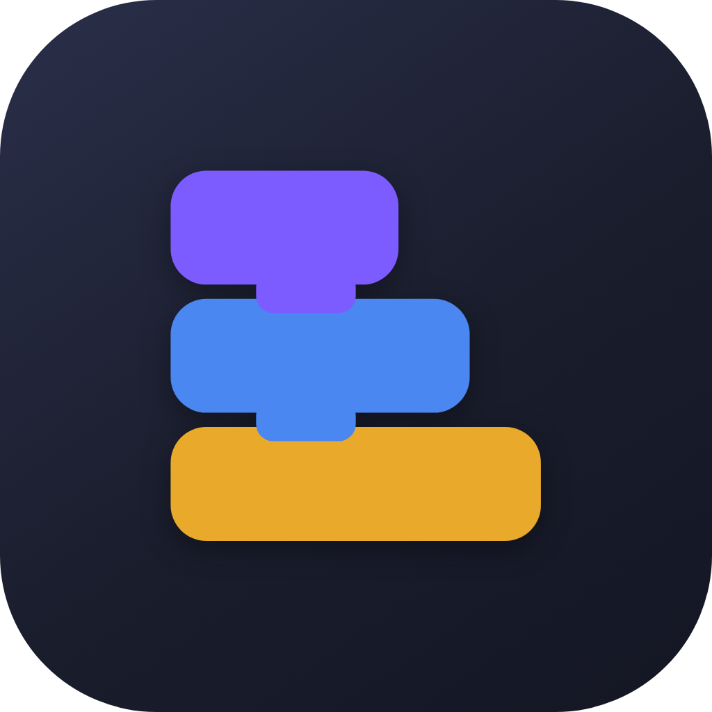
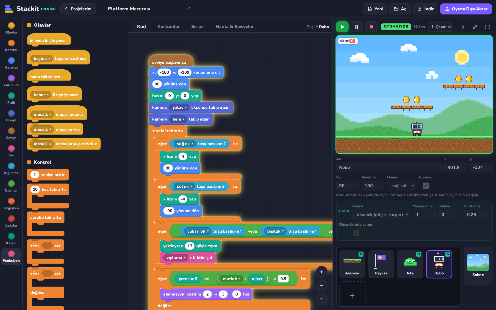
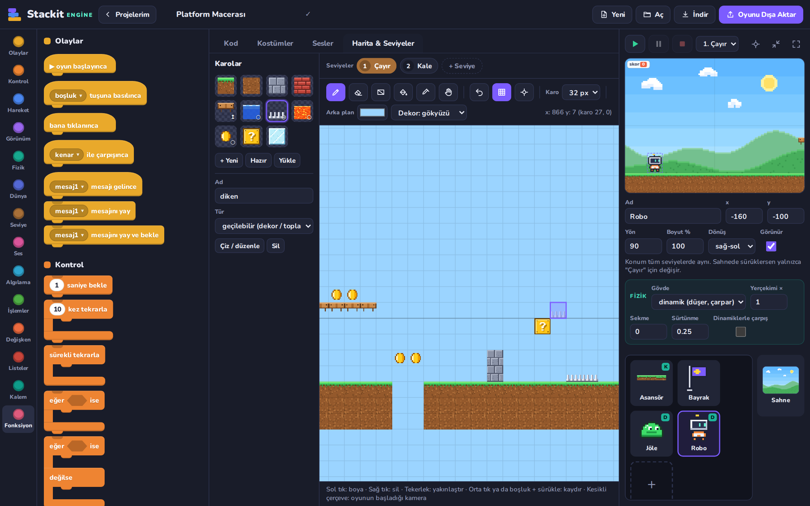
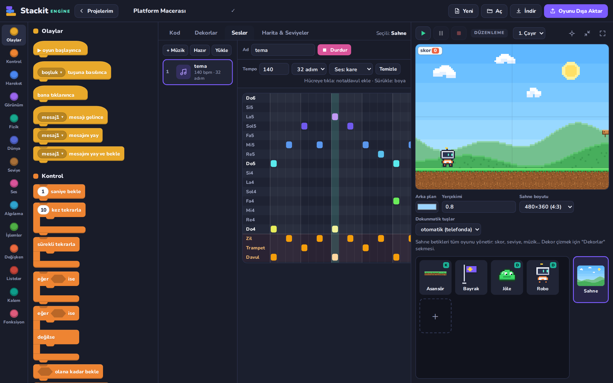
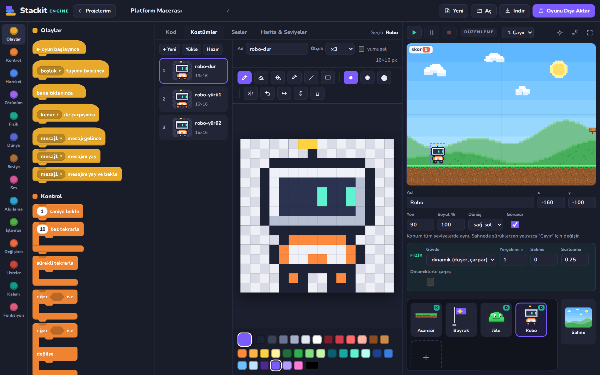
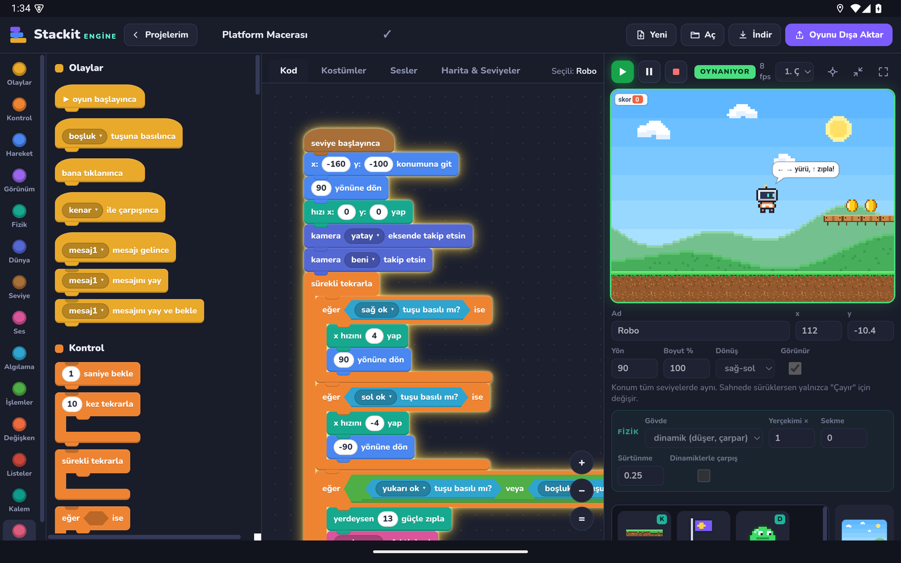
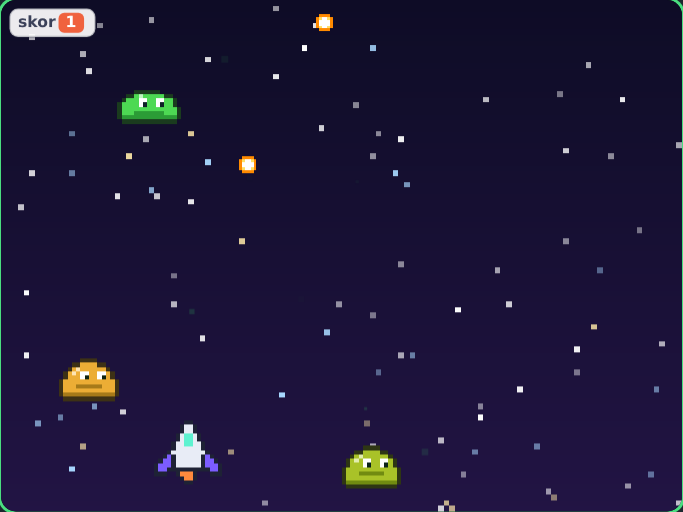

<p align="center">
  
</p>

<h1 align="center">Stackit Engine</h1>

<p align="center">
  <b>Scratch tarzı bloklarla gerçek 2D oyunlar yap.</b><br>
  Fizik, karo haritaları, seviyeler, müzik yapıcı, piksel editörü — Windows, Linux, Android ve tarayıcıda.
</p>

<p align="center">
  <a href="https://github.com/isnowx17/StackitEngine/releases/latest"></a>
  <a href="LICENSE"></a>
  
  
</p>

<p align="center">
  <a href="#indir"><b>⬇ İndir</b></a> ·
  <a href="#ekran">Ekran görüntüleri</a> ·
  <a href="#ozellikler">Özellikler</a> ·
  <a href="#derleme">Derleme</a>
</p>



Kodu sürükle-bırak bloklarla yazarsın; altında **sabit 60 Hz simülasyon döngüsü**, fizik, kamera, klonlar, parçacıklar ve piksel hassasiyetinde çarpışma algılama olan gerçek bir motor çalışır. Bitirdiğin oyunu **tek bir HTML dosyası** olarak dışa aktarıp her tarayıcıda — telefonda dokunmatik tuşlarla — oynatabilirsin.

<a id="indir"></a>

## ⬇ İndir

| Platform | Dosya | Not |
|---|---|---|
| **Windows 10/11** | [Stackit-Engine-1.0.0-windows-portable.exe](https://github.com/isnowx17/StackitEngine/releases/latest/download/Stackit-Engine-1.0.0-windows-portable.exe) | Tek dosya, kurulum gerekmez |
| Windows 10/11 | [Stackit-Engine-1.0.0-windows-x64.zip](https://github.com/isnowx17/StackitEngine/releases/latest/download/Stackit-Engine-1.0.0-windows-x64.zip) | Klasörü aç, `Stackit Engine.exe` |
| **Linux** | [Stackit-Engine-1.0.0-linux-x86_64.AppImage](https://github.com/isnowx17/StackitEngine/releases/latest/download/Stackit-Engine-1.0.0-linux-x86_64.AppImage) | `chmod +x` yap, çalıştır |
| Debian / Ubuntu | [Stackit-Engine-1.0.0-linux-amd64.deb](https://github.com/isnowx17/StackitEngine/releases/latest/download/Stackit-Engine-1.0.0-linux-amd64.deb) | `sudo apt install ./Stackit-Engine-1.0.0-linux-amd64.deb` |
| **Android 7+** | [Stackit-Engine-1.0.0-android.apk](https://github.com/isnowx17/StackitEngine/releases/latest/download/Stackit-Engine-1.0.0-android.apk) | Tablet önerilir; yatay ekran |
| Google Play paketi | [Stackit-Engine-1.0.0-android.aab](https://github.com/isnowx17/StackitEngine/releases/latest/download/Stackit-Engine-1.0.0-android.aab) | Play Console için |
| **Tarayıcı** | Bu repoyu indir, `index.html`'i aç | Kurulum yok, çevrimdışı çalışır |

> **İlk açılışta uyarı çıkabilir:** Windows dosyaları imzasız olduğu için SmartScreen "Windows bilgisayarınızı korudu" diyebilir → **Ek bilgi → Yine de çalıştır**. Android'de APK'yı kurmak için tarayıcına/dosya yöneticine "bilinmeyen uygulamaları yükleme" izni ver. Bazı Linux dağıtımlarında AppImage için `libfuse2` gerekir.

<a id="ekran"></a>

## 📸 Ekran görüntüleri

| Projelerim | Karo haritası ve seviyeler |
|---|---|
|  |  |
| **Müzik yapıcı (notalar + davul)** | **Piksel kostüm editörü** |
|  |  |
| **Android tablette** | **Uzay Atıcı örneği** |
|  |  |

<a id="ozellikler"></a>

## ✨ Neler var?

| | |
|---|---|
| **Blok editörü** | 14 kategori, ~150 blok. Yapboz çentikli bloklar, C blokları (eğer/değilse, döngüler), değer ve mantık yuvaları, açılır menüler. Yakınlaştırma, kaydırma, geri al/yinele, sağ tık menüsü (çoğalt/sil/düzenle). |
| **Motor** | Sabit adımlı 60 Hz döngü, generator tabanlı çoklu iş parçacığı (yüzlerce betik aynı anda), kamera (takip, eksen kilidi, yakınlaştırma, sarsıntı), klonlar (300'e kadar), parçacık sistemi, kalem katmanı, konuşma balonları, değişken göstergeleri. |
| **Fizik** | Dinamik gövdeler (yerçekimi, sürtünme, sekme), katı gövdeler (zemin/duvar), *yerde mi? / duvara çarptı mı? / tavana çarptı mı?* algılayıcıları, kinematik hız. **Hareketli platformlar üstündeki karakteri taşır**; istenirse dinamik karakterler birbirine çarpar ve üst üste durur. |
| **Karo haritası** | Seviyeleri ızgaraya boyayarak çiz: kalem, silgi, dikdörtgen, kova, damlalık, kaydırma, geri al. Karo türleri: *katı*, *tek yönlü* (altından geçilir, üstüne basılır), *geçilebilir* (altın, diken, lav, su…). 11 hazır karo; kendin de çizebilirsin. |
| **Seviyeler** | Her seviyenin kendi haritası, arka planı, dekoru ve karakter başlangıç konumları. `seviye başlayınca`, `sonraki seviyeye geç` blokları; skor gibi değişkenler seviyeler arasında korunur. |
| **Müzik & ses** | Ses dosyası yükle (mp3/wav/ogg) ya da **adım tabanlı müzik yapıcıda** notalar + davul/trampet/zil ile kendi müziğini yap. Dosya gerektirmeyen ses efektleri (zıplama, altın, patlama, lazer…) ve nota çalma. |
| **Çarpışma** | Saydam pikseller kırpılmış sınır kutuları + piksel hassasiyetinde dokunma testi; *X ile çarpışınca* olay bloğu. |
| **Kostüm editörü** | Piksel çizim: kalem, silgi, kova, damlalık, çizgi, dikdörtgen, ayna çizim, çevirme, geri al. Resim yükleme ve hazır piksel-art kütüphanesi. |
| **Fonksiyonlar** | Parametreli kendi blokların; "ekranı yenilemeden çalıştır" (warp) seçeneği. |
| **Projelerim** | Açılışta proje ekranı: *Yeni proje oluştur* (boş ya da örnekten), *Devam et*, önizlemeli proje kartları, arama, sıralama; yeniden adlandır / çoğalt / indir / sil. Projeler IndexedDB'de otomatik kaydedilir. |
| **Dışa aktarma** | `.stackit` proje dosyası indir / içe aktar. **Tek dosya HTML oyun**: her tarayıcıda açılır, telefonda otomatik dokunmatik yön tuşları + A tuşu. |

## 🎮 Örnek projeler

- **Platform Macerası** — karo haritalı 2 seviye (Çayır → Kale), hareketli asansör, soru kutusu, diken ve lav, altın toplama, düşmanın üstüne zıplama, arka plan müziği.
- **Uzay Atıcı** — klonlarla mermiler ve düşmanlar, tuş olayları, parçacık patlamaları.

Projelerim ekranındaki **Örnekten başla** bölümünden açılır.

## 🧠 Nasıl çalışır?

- **Projeler:** motoru açınca *Projelerim* ekranı gelir. Editördeyken adres `#/p/<id>` olur; sayfayı yenilersen proje açık kalır, geri tuşu Projelerim'e döner. Projeyi başka bir bilgisayara taşımak ya da yedeklemek için **İndir** ile `.stackit` dosyası al.
- **Düzenleme modu / Oyun modu:** ▶ ile oyun sahnenin bir kopyası üzerinde çalışır; ■ ile sahne kurduğun başlangıç haline döner (gerçek oyun motorlarındaki gibi). Düzenleme modunda karakterleri sahnede sürükleyerek yerleştir, tekerlekle yakınlaştır, boş yeri sürükleyerek kaydır.
- **Koordinatlar:** merkez (0,0), x sağa, y yukarı. Yön: 90 = sağ, 0 = yukarı.
- **Seviyeler:** ▶, o an düzenlediğin seviyeden başlar; dışa aktarılan oyun hep 1. seviyeden başlar. Karakteri sahnede sürüklemek konumunu yalnızca düzenlenen seviye için değiştirir.
- **Karo koordinatları:** karo boyutu 32 ise (0,0) karosu x 0–32, y 0–32 arasını kaplar.
- **Fizik birimleri** kare başınadır: `x hızı 4` = saniyede 240 piksel; `yerçekimi 0.8` = her kare hız 0.8 azalır.
- **Bir betiğe tıkla** → yalnızca o betik çalışır (parlar). Bir değer bloğuna tıkla → değeri baloncukta görünür. Bloğu **palete geri sürükle** → silinir.

### Kısayollar

| Kısayol | İş |
|---|---|
| `Ctrl+Enter` | Oyna / durdur |
| `Ctrl+Z`, `Ctrl+Shift+Z` / `Ctrl+Y` | Geri al / yinele |
| `Ctrl+S` | Kaydet |
| `Ctrl+tekerlek` | Çalışma alanını yakınlaştır |
| `B E G I L R` | Kostüm editörü araçları |
| `B E R G I H`, `boşluk + sürükle` | Harita editörü araçları / kaydırma |

<a id="derleme"></a>

## 🛠 Kaynaktan çalıştırma ve derleme

Editör derleme adımı istemez — saf HTML/CSS/JS:

```bash
git clone https://github.com/isnowx17/StackitEngine.git
cd StackitEngine
npm start                # → http://localhost:8080  (ya da index.html'i doğrudan aç)
```

Masaüstü ve Android paketleri için:

```bash
npm install
npm run desktop          # Electron'da geliştirme modunda aç
npm run dist:linux       # AppImage + .deb
npm run dist:win         # taşınabilir .exe + .zip (Linux'ta da wine gerekmez)
npm run dist:win-setup   # klasik kurulum sihirbazı (NSIS) — Linux'ta wine gerekir
npm run android:apk      # web → Capacitor senkron → imzalı APK + AAB
```

Çıktılar `release/` (masaüstü) ve `android/app/build/outputs/` (Android) klasörlerine düşer.

**Android** için JDK 21 ve Android SDK gerekir:

```bash
export JAVA_HOME=/yol/jdk-21
export ANDROID_HOME=~/Android/Sdk
```

Sürüm imzası için `android/keystore.properties` dosyası oluştur (git'e girmez):

```properties
storeFile=stackit-release.jks
storePassword=…
keyAlias=stackit
keyPassword=…
```

Bu dosya yoksa Gradle imzasız bir sürüm APK'sı üretir; `./gradlew assembleDebug` ile hata ayıklama APK'sı da alabilirsin.

### Android'e özel davranışlar ([`js/platform/android.js`](js/platform/android.js))

- **Geri tuşu:** açık pencereyi kapatır → oyunu durdurur → Projelerim'e döner → uygulamadan çıkar.
- **İndir / Oyunu dışa aktar:** Android WebView dosya indiremediği için dosya hazırlanır ve paylaşım menüsü açılır (Dosyalar'a kaydet, Drive, Quick Share…).
- Uygulama arka plana geçince oyun duraklar ve bekleyen kayıt hemen yazılır.
- Ekran yatay kilitlidir; telefonlarda editör 1180 px genişlikte çizilip ekrana sığdırılır.

## 📁 Klasör yapısı

```
index.html, css/          editör arayüzü (Nunito yazı tipi gömülü)
js/runtime/               motor — dışa aktarılan oyunlara da gömülür
  core.js                   yardımcılar, modül sistemi
  audio.js                  ses: efekt sentezi, dosyalar, adım tabanlı müzik
  engine.js                 aktörler, fizik, karo haritası, seviyeler, kamera, çizim, girdi
  vm.js                     betik yorumlayıcısı (thread'ler)
  blocks.js                 tüm blok tanımları ve davranışları
  player.js                 bağımsız oynatıcı + dokunmatik tuşlar
js/editor/                editör
  blockview.js, workspace.js, palette.js     bloklar, sürükle-bırak, palet
  costumes.js, mapeditor.js, sounds.js       piksel, harita ve ses editörleri
  library.js, examples.js                    hazır piksel-art, karolar, melodiler, örnekler
  store.js, home.js, app.js                  proje deposu, Projelerim ekranı, uygulama
js/platform/android.js    Android (Capacitor) uyarlamaları
electron/                 masaüstü (Electron) ana süreci
android/                  Capacitor Android projesi
scripts/build-web.js      web dosyalarını Capacitor için paketler
```

**Yeni blok eklemek** için `js/runtime/blocks.js` içinde `def('benim_blogum', { cat, shape, text, args, run })` yazman yeterli; palet ve editör otomatik tanır.

## 📄 Lisans

[MIT](LICENSE). Gömülü Nunito yazı tipi [SIL Open Font License](css/fonts/OFL-Nunito.txt) ile dağıtılır.
